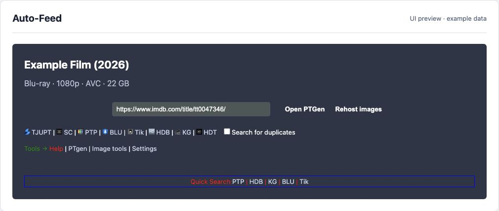
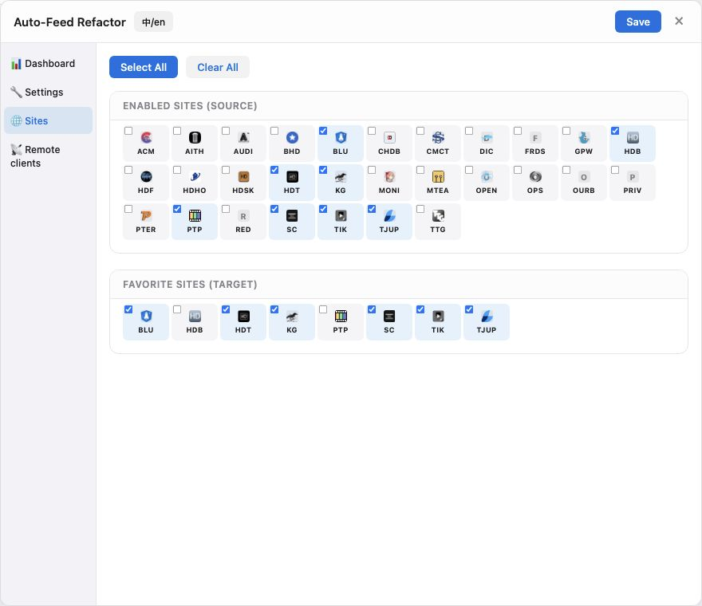
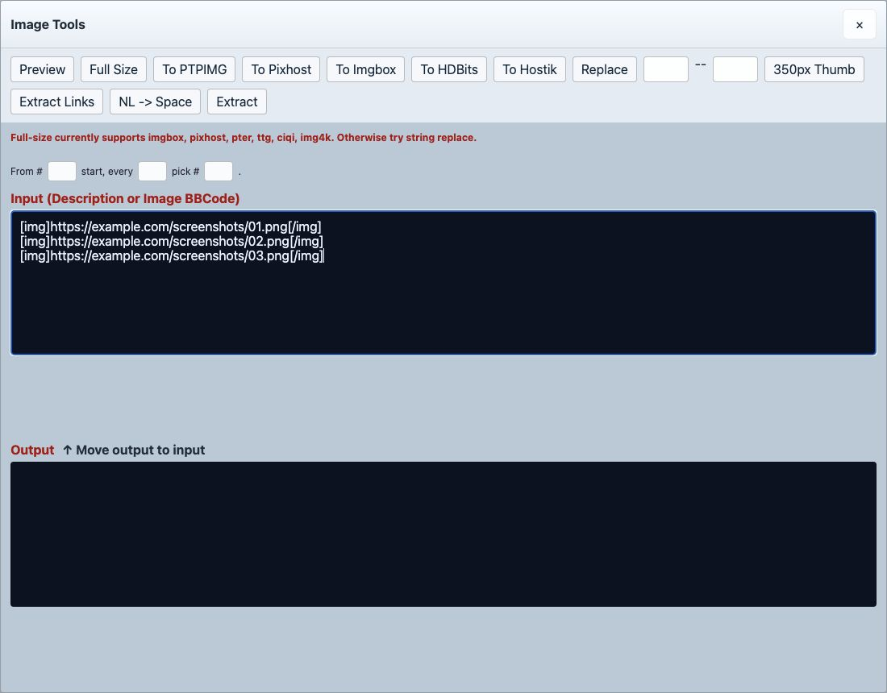
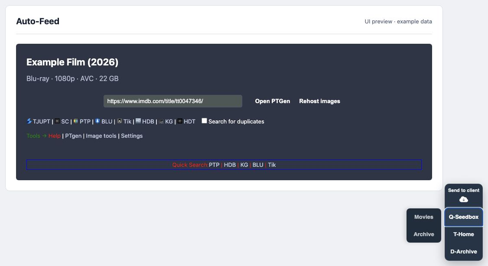
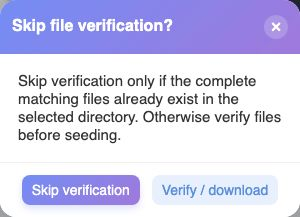
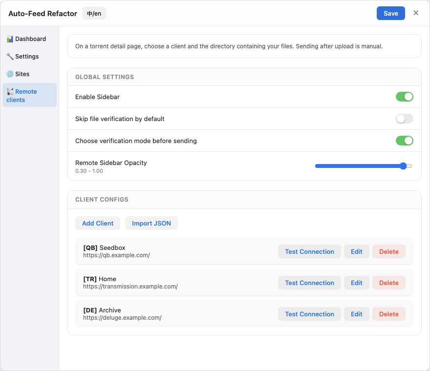
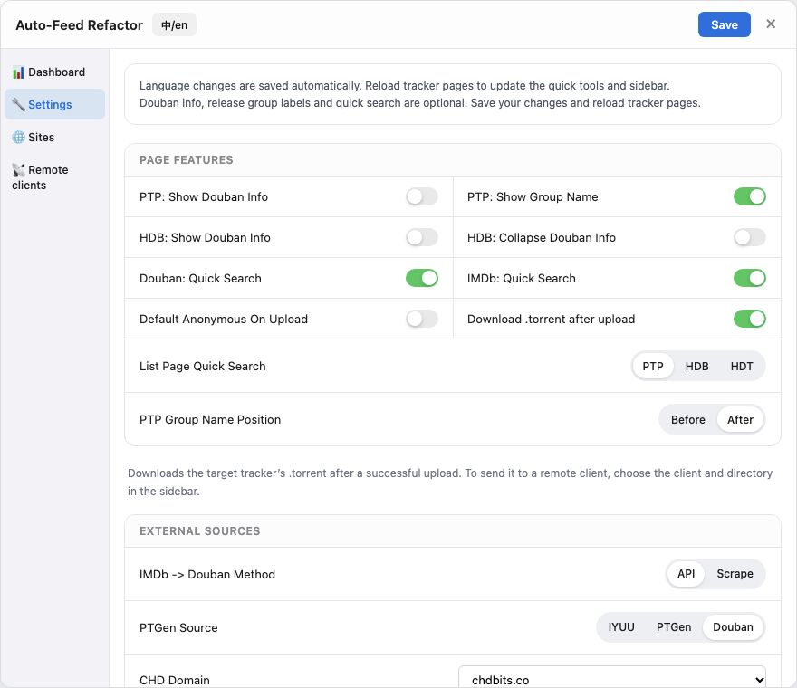
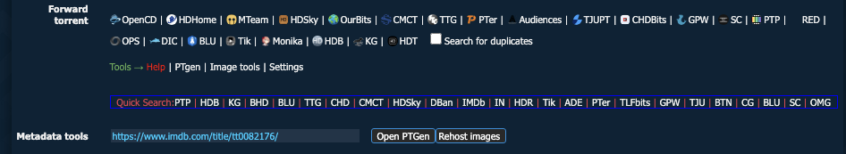
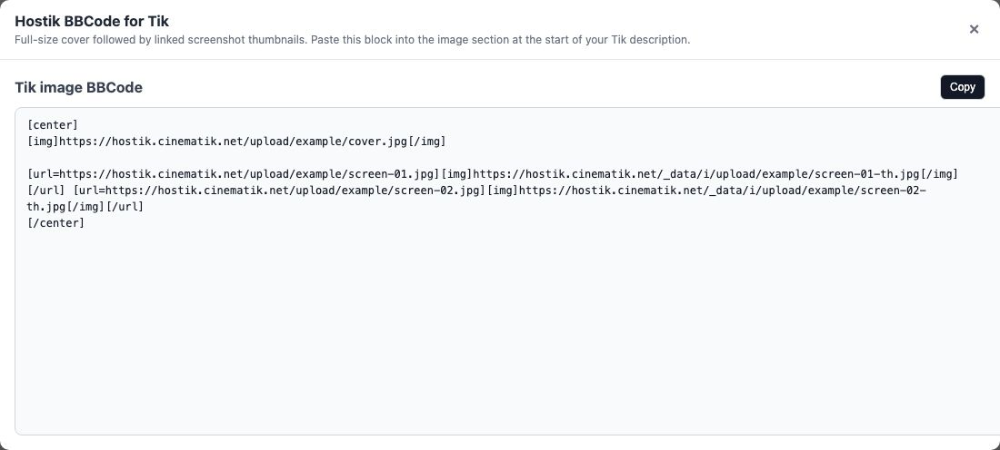

# Auto-Feed｜PT Cross-Site Torrent Assistant (Refactored)

Current refactored source: <https://github.com/Gawain12/auto_feed_js/tree/refactor-dev>

Original project’s mainline: <https://github.com/tomorrow505/auto_feed_js/tree/dev>

Auto-Feed helps prepare a torrent release for another supported tracker. From a torrent details page, choose a destination; the script carries over the torrent file and available metadata, screenshots and media information, then fills fields supported by that destination. On the upload page, check for duplicates, review and edit the prefilled content, and submit only when you are ready.

Many users know Auto-Feed from the original script by tomorrow505. This refactor was developed together with the original author to make the familiar cross-site workflow easier to maintain and extend. It organizes tracker adapters, metadata extraction, form filling, image tools and remote-client features into clearer modules. Support and available fields vary by site, and some smaller trackers and edge cases are still being adapted. When reporting a problem, include the source and destination tracker names; do not share passkeys or client credentials.

## Main features

- **Cross-site forwarding & smart site filtering:** Choose a destination from a source torrent page to prepare its upload form. The forwarding bar automatically separates music, movie, TV, book, and game trackers by default (keeping `PTP ↔ BTN` miniseries overlap), with a one-click toggle to reveal other sites.
- **Music trackers & CD `.log` forwarding:** Full two-way support across `RED`, `OPS`, `DIC`, and `OpenCD` (including automatic single/multi-disc CD rip `.log` transfer), plus `jpop` and `lztr` as source sites.
- **Duplicate checks and quick search:** Open a destination’s duplicate-search page or use quick-search links for commonly used trackers. Check the results before uploading.
- **Metadata assistance:** Organize titles, descriptions, IMDb, Douban, PTGen, and common release fields, plus one-click BBCode copy on Douban movie pages.
- **Image tools:** Extract and preview image URLs or BBCode, resolve supported thumbnail links, replace text, and prepare images for supported hosts. Follow the image rules of the destination tracker.
- **English UI & site catalog:** Open **Settings** or press **Alt+S** to switch between Chinese and English, toggle optional page enhancers, and search/enable sites (untested legacy sites are collapsed under **Experimental** by default). Click **Save** to apply your changes.
- **Remote clients:** Configure qBittorrent, Transmission or Deluge and name download directories. On a torrent details page, choose a client and directory in the sidebar to send the torrent manually; verification options are available. Uploading does not automatically send or seed the release.
- **Download after upload:** An optional setting downloads the destination’s `.torrent` file after a forwarded upload succeeds. This is separate from manually sending a torrent through the sidebar.

## Site-specific examples

Trackers have different fields, image rules and upload flows. On Tik (`cinematik.net`) and Hostik, upload helper controls always appear in English: the upload form fills the title and description template while keeping images blank so you can click **Prepare images for Hostik**, upload there, and paste the generated BBCode back. The script never submits the upload for you.

For Tik’s `Film Aspect Ratio` field, Auto-Feed tries IMDb and Wikidata automatically; if IMDb blocks background fetching, click **Fetch ratio from IMDb** right above the description box to read and fill only the aspect-ratio line.

## Recent Changes

Full release notes are available on [GitHub Releases](https://github.com/Gawain12/auto_feed_js/releases) and in [CHANGELOG.md](https://github.com/Gawain12/auto_feed_js/blob/refactor-dev/CHANGELOG.md).

### v5.2.0
- **+126 new trackers (155 total)**: Live-verified two-way music forwarding across `RED`, `OPS`, `DIC`, and `OpenCD` (with single/multi-disc CD `.log` transfer); added and verified `BTN`, `AvistaZ` / `CinemaZ` / `PrivateHD`, `CG`, `HDT`, `FileList`, `bib`, `jpop`, `lztr`, plus `HDChina`, `PThome`, `BTSchool`, `HDArea`, `HDTime`, `HDDolby`, `TCCF`, `HDfans`, `TLFbits`, and `FRDS`. Aligned all active legacy trackers (110 untested smaller sites stay collapsed under Experimental).
- **Smart content-domain filtering**: Automatically isolates music, movie, TV, book, and game sites in the forwarding bar (preserving `PTP ↔ BTN` miniseries overlap) with one-click expand.
- **Flow & stability fixes**: Fixed foreign-to-CN PTGen handoff, `CMCT` editor/field duplication, and 4K Dolby Vision UHD discs misdetected as `1080p`; switched Settings to explicit click-to-save and reduced false-positive exclusive warnings for site-specific notices like `禁转至PTT`.

### v5.1.1
- Fixed the missing remote-push sidebar on Gazelle trackers such as GPW, RED, OPS, and DIC (now matches `action=download&id=...` torrent links).
- Fixed remote-push sidebar positioning, narrow/flickering path submenus, stale cross-page cache fallback, and response validation for torrent downloads and qBittorrent / Transmission pushes.
- Added SPA route-change detection (e.g., M-Team) so forwarding tools and the remote-push sidebar mount without manual refreshes; improved download-link and detail-page detection on Unit3D, BHD mirror domains, and PrivateHD.
- Fixed double-escaped regex bugs affecting PTP title scoring, Unit3D season/episode parsing, English anonymous upload labels, BHD thumbnails, PTer BDInfo blocks, and the image toolbox URL extractor.

## Screenshots

The examples below include a general tools view and one live tracker-page example. Other previews use example data and client addresses; no real upload was submitted and no client transfer was started. Tracker themes and layouts may differ.

### General tools

### Examples from individual tracker pages

