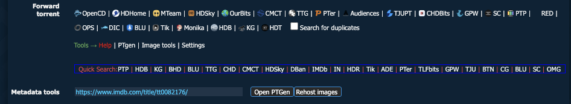

# Auto-Feed｜PT 一键转种助手（重构版）

当前重构分支：<https://github.com/Gawain12/auto_feed_js/tree/refactor-dev>

原项目新版主线：<https://github.com/tomorrow505/auto_feed_js/tree/dev>

Auto-Feed 用于在支持的 PT 站点之间整理和转发种子信息：从种子详情页选择目标站，脚本会尽可能带上种子文件、标题、简介、媒体信息和图片，并填写目标站支持的字段。打开目标站发布页后，请先检查查重结果，再核对并修改预填内容，最后由你决定是否发布。

不少用户熟悉的 Auto-Feed 原版由 tomorrow505 开发；这个重构版是与原作者一起完成的，保留熟悉的跨站转发流程，并把站点适配、信息提取、自动填表、图片工具和远程推送整理得更便于维护和扩展。不同站点的页面和字段各有差异，部分小站与边缘流程仍在迁移适配中。反馈问题时请注明来源站和目标站，不要贴 passkey 或客户端凭据。

## 主要功能

- **跨站转发与类型智能隔离：** 从来源站种子详情页选择目标站，自动准备目标站发布表单；转发栏默认按内容类型隔离音乐、电影、剧集、书籍与游戏站（保留 `PTP ↔ BTN` 迷你剧互通），旁侧可一键展开其余站点。
- **音乐站与 CD `.log` 透传：** 支持 `RED` / `OPS` / `DIC` / `OpenCD` 双向转发与单碟/多碟 CD 抓轨 `.log` 自动上传填表，同时支持 `jpop` / `lztr` 仅源站。
- **查重与快速搜索：** 可先打开目标站查重页面，也可用快捷搜索入口查询常用站点。进入发布页后仍建议检查查重结果。
- **信息补全与豆瓣增强：** 整理标题、简介、IMDb、豆瓣、PTGen 等媒体信息及常见发布字段，并支持在豆瓣详情页一键复制完整 PTGen 简介。
- **图片工具：** 提取和预览图片链接或 BBCode、处理缩略图链接、替换文本，并为支持的图床准备图片。各站发布规则不同，请使用目标站允许的图片来源和流程。
- **中英文界面与站点分组：** 在“脚本设置”或按 **Alt+S** 打开设置，可切换中英文、开关页面增强，并在站点页搜索启用站点（未逐一实测的小站默认折叠在「实验性适配站点」分组中）；调整后点击右上角 **保存** 生效。
- **远程客户端：** 可配置 qBittorrent、Transmission 或 Deluge，并设置下载目录。在种子详情页侧边栏选择客户端和目录后手动推送；可设置校验方式。发布后不会自动推送或开始做种。
- **发布后下载种子：** 可选在转发发布成功后下载目标站的 `.torrent` 文件；这与侧边栏的手动客户端推送分开。

## 站点差异示例

各站的字段、图片规则和页面流程并不相同。例如，Tik 的发布页与 Hostik 助手统一使用英文提示，会根据现有信息填写英文标题和简介模板；图片栏留空，点击 **Prepare images for Hostik** 可把本次转发携带的图片带到 Hostik 页面，上传后再将生成的 BBCode 放回简介。脚本不会替你提交发布。

对于 Tik 的电影画幅比（`Film Aspect Ratio`）字段，脚本会自动尝试从 IMDb / Wikidata 读取电影原始画幅比；如因 IMDb 限制未能自动获取，可点击上传页的 **Fetch ratio from IMDb** 一键读取并回填。

## 最近更新

完整更新记录见 [GitHub Releases](https://github.com/Gawain12/auto_feed_js/releases) 与 [CHANGELOG.md](https://github.com/Gawain12/auto_feed_js/blob/refactor-dev/CHANGELOG.md)。

### v5.2.0
- **新增 126 个站点（总计 155 站）**：完成 `RED` / `OPS` / `DIC` / `OpenCD` 四大音乐站双向实测（支持 CD `.log` 自动透传）；实测新增 `BTN`、`AvistaZ` / `CinemaZ` / `PrivateHD`、`CG`、`HDT`、`FileList`、`bib`、`jpop`、`lztr` 及 `HDChina` / `PThome` / `BTSchool` / `HDArea` / `HDTime` / `HDDolby` / `TCCF` / `HDfans` / `TLFbits` / `FRDS` 等站，并对齐原版全部活跃站（110 个未实测小站折叠至实验性分组）。
- **站点类型智能隔离**：转发栏自动隔离音乐 / 电影 / 剧集 / 书籍 / 游戏站（保留 `PTP ↔ BTN` 迷你剧互通），支持一键展开。
- **链路与交互修复**：修复外站转内站 PTGen、`CMCT` 表单重复填充与 4K 杜比视界原盘分辨率误判；设置页改为点击保存统一生效，并减少定向禁转（如 `禁转至PTT`）误报。

### v5.1.1
- 修复 GPW / RED / OPS / DIC 等 Gazelle 站点不显示远程推送侧边栏的问题（兼容 `action=download&id=...` 下载链接匹配）。
- 修复远程推送侧边栏定位偏移、子菜单过窄易收起、缓存未校验当前页 URL 以及 qB/TR 推送结果与种子响应校验问题。
- 为 M-Team 等 SPA 页面增加路由切换监听，切进详情页无需手动刷新即可挂载转种栏与远程推送侧边栏；补全 Unit3D / BHD 镜像域 / PrivateHD 下载链接与详情页识别。
- 修复 PTP 标题识别、Unit3D 季集号、英文匿名上传开关、BHD 缩略图、PTer BDInfo 与图片工具中的多处正则转义缺陷。

## 界面预览

下方先展示通用工具界面，再展示一个实际站点页面示例。其余预览使用示例数据和客户端地址；没有提交真实发布，也没有向客户端推送任务。各站主题和页面布局可能不同。

### 站点页面示例

以下为一个实际站点页面示例，展示种子详情页工具栏与快速搜索入口。

